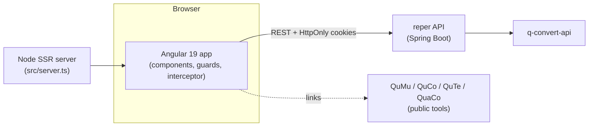
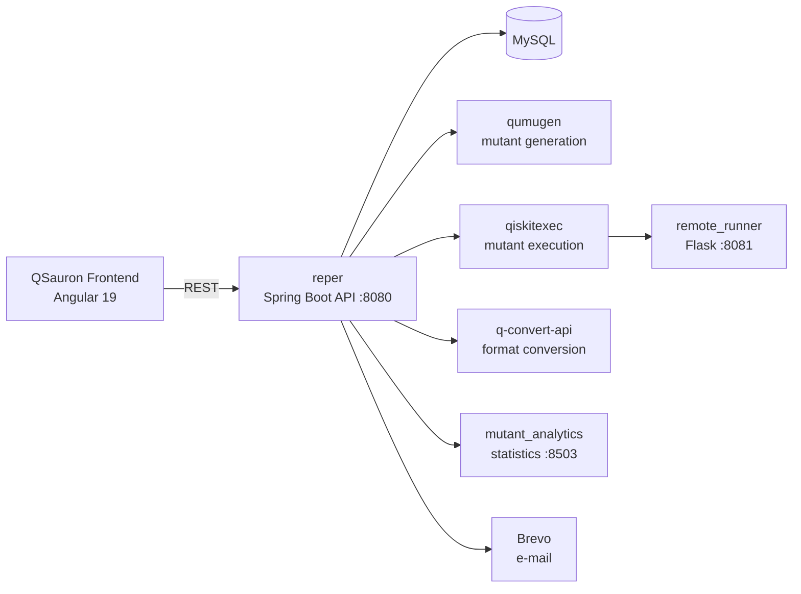

<p align="center">
  
</p>

# QSauron Frontend

> Web client for **QSauron**: manage quantum mutation-testing projects, launch experiments and inspect their results from a single, secure dashboard.


## Table of contents

- [Overview](#overview)
- [Features](#features)
- [Architecture](#architecture)
- [Getting started](#getting-started)
- [Routes](#routes)
- [Usage](#usage)
- [Project structure](#project-structure)
- [Testing](#testing)
- [QSauron ecosystem](#qsauron-ecosystem)
- [Roadmap](#roadmap)
- [License](#license)

## Overview

Quantum programs are hard to test: a single faulty gate can silently change a circuit's output distribution. **QSauron** applies *mutation testing* to quantum circuits — it generates mutants of a circuit, executes them and tells you which ones your test suite is able to kill.

This repository is the **web front end**. It authenticates users against the [`reper`](https://github.com/AlarcosQuantumTesting/QSauron) backend, lists and imports projects, shows project details and notes, and offers a quantum-code converter for administrators. Its visual style follows the Qumuclient front end so every piece of the ecosystem feels the same.

## Features

| Area | What you get |
|---|---|
| Authentication | Registration, login, optional two-factor authentication (QR + code) and password recovery (request → validate → reset) |
| Session security | JWT delivered as **HttpOnly cookies** (`SESSION_TOKEN`, `REFRESH_TOKEN`), automatic token refresh through an HTTP interceptor, route guards |
| Projects | Dashboard, project details, project notes, project import |
| Code converter | Translate circuits between formats (admin only), served through `reper` |
| UX | Light/dark theme, cookie-consent banner, responsive layout, server-side rendering |

## Architecture



More diagrams (login/2FA sequence, route guards) are in [`docs/ARCHITECTURE.md`](docs/ARCHITECTURE.md). Theme and authentication notes are in [`docs/THEME_AND_AUTH.md`](docs/THEME_AND_AUTH.md).

## Getting started

### Prerequisites

- Node.js 20+ and npm
- Angular CLI 19 (`npm install -g @angular/cli`) — optional, `npx ng` works too
- A running [`reper`](https://github.com/AlarcosQuantumTesting/QSauron) backend (default `http://localhost:8080`)

### Install

```bash
git clone git@github.com:SamRo28/QSauron.git
cd QSauron
npm install
```

### Configuration

Endpoints live in `src/environments/environment.ts` (development) and `src/environments/environment.prod.ts` (production):

| Key | Purpose |
|---|---|
| `apiUrl` | Base URL of the `reper` backend (e.g. `http://localhost:8080`) |
| `quMuUrl` | Link target for QuMu |
| `quCoUrl` | Link target for QuCo |
| `quTeUrl` | Link target for QuTe |
| `quaCoUrl` | Link target for QuaCo |

### Run

```bash
npm start          # ng serve → http://localhost:4200
npm run build      # production build into dist/
npm run serve:ssr:nombre-del-proyecto   # serve the SSR build (after npm run build)
```

> The npm package is still called `nombre-del-proyecto`; the `serve:ssr` script and `angular.json` reference that name.

## Routes

| Path | Component | Access |
|---|---|---|
| `/` | Home | Public |
| `/login`, `/register` | Login / registration | Public |
| `/2fa-qr`, `/2fa-code` | Two-factor setup / verification | Public (post-login flow) |
| `/recovery/request`, `/recovery/validate`, `/recovery/reset` | Password recovery | Public |
| `/dashboard` | Dashboard home | `authGuard` |
| `/dashboard/project/:id` | Project details and notes | `authGuard` |
| `/dashboard/import` | Project import | `authGuard` |
| `/dashboard/converter` | Code converter | `authGuard` + `adminGuard` |

## Usage

1. Register at `/register` (or log in at `/login`; activate 2FA if you want it).
2. Open the dashboard and pick a project in the side bar, or import one from `/dashboard/import`.
3. Review its circuits, mutants and notes in the project view.
4. Administrators can open the converter to translate a circuit between formats.

| Login | Dashboard | Project details |
|---|---|---|
|  |  |  |


## Project structure

```text
src/
├── app/
│   ├── components/     # login, register, dashboard, project-details, project-import, code-converter, recovery-*, fa2-*…
│   ├── guards/         # auth.guard.ts, admin.guard.ts
│   ├── interceptors/   # auth.interceptor.ts (cookies + token refresh)
│   ├── models/         # project, mutant-cycle, q-circuit, converter…
│   ├── services/       # auth, converter, project-import, project-events, theme
│   ├── styles/         # variables.css (theme tokens)
│   └── utils/          # import-file helpers
├── environments/       # environment.ts / environment.prod.ts
└── server.ts           # SSR entry point
public/assets/          # logos and tool icons
docs/                   # architecture and theme notes
```

## Testing

```bash
npm test    # Karma + Jasmine unit tests
```

## QSauron ecosystem



| Repository | Role |
|---|---|
| [QSauron (reper)](https://github.com/AlarcosQuantumTesting/QSauron) | Main REST API and persistence |
| [QSauron Frontend](https://github.com/SamRo28/QSauron) | This repository |
| [Qumuclient](https://github.com/SamRo28/Qumuclient) | Original UI plus `qumugen` and `qiskitexec` back ends |
| [q-convert-api](https://github.com/SamRo28/q-convert-api) | REST wrapper around the `q-convert` CLI |
| [QuCo `remote_runner`](https://github.com/AlarcosQuantumTesting/QuCo) | Remote execution of Qiskit/Cirq programs |

## Roadmap

- [ ] Add end-to-end tests
- [ ] Rename the npm package from `nombre-del-proyecto` to `qsauron-frontend`
- [ ] Publish screenshots and a short demo GIF
- [ ] Internationalization (i18n)

## License

Released under the [MIT License](LICENSE).
